# LAPORAN PRAKTIKUM 06

## RELASI & TRANSAKSI PESERTA

### A. Tujuan Praktikum

Praktikum Pertemuan 06 bertujuan untuk memahami dan menerapkan relasi antartabel serta transaksi database dalam proses pendaftaran peserta ke suatu jadwal. Praktikum ini berfokus pada penerapan transaksi dengan tingkat isolasi `Serializable` untuk menjaga konsistensi data ketika beberapa pengguna melakukan pendaftaran secara bersamaan.

Tujuan praktikum meliputi:

1. Memahami relasi antara tabel `User`, `Jadwal`, dan `Peserta`.
2. Menerapkan proses pendaftaran peserta dengan pemeriksaan kapasitas dan pendaftaran ganda.
3. Menerapkan transaksi database menggunakan tingkat isolasi `Serializable`.
4. Memahami mekanisme retry ketika terjadi konflik transaksi.
5. Menerapkan pembatalan pendaftaran dan penghapusan jadwal dengan cascade.
6. Melakukan pengujian kapasitas, unit test, dan database test.

### B. Persiapan Praktikum

Praktikum menggunakan backend yang telah dikembangkan pada pertemuan sebelumnya. Sebelum implementasi dilakukan, dependensi, konfigurasi database, dan backend dipastikan telah tersedia.

Teknologi yang digunakan:

1. Visual Studio Code.
2. Node.js dan npm.
3. MySQL melalui XAMPP.
4. Prisma ORM.
5. Postman atau alat pengujian API.
6. PowerShell.

#### 1. Mengaktifkan Database MySQL

Database MySQL diaktifkan melalui aplikasi XAMPP Control Panel dengan menjalankan layanan MySQL. Database digunakan sebagai tempat penyimpanan data pengguna, jadwal, dan peserta.

**Bukti database aktif:**

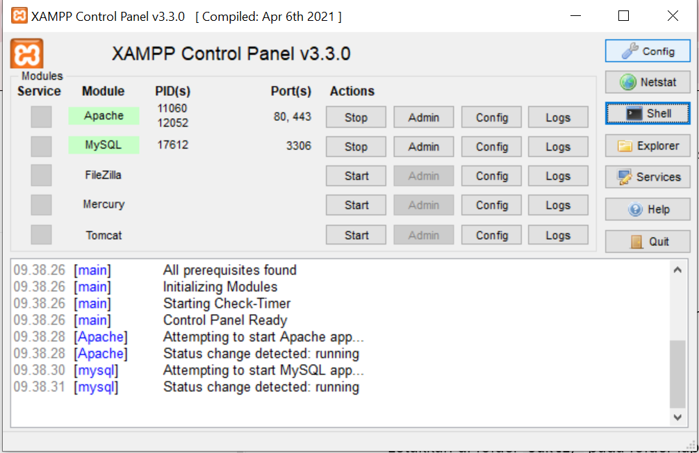

#### 2. Menjalankan Backend

Setelah database aktif dan konfigurasi koneksi tersedia, backend dijalankan melalui terminal menggunakan perintah:

```bash
npm run dev
```

Backend dijalankan pada port 3000 untuk menyediakan layanan API yang digunakan selama praktikum.

**Bukti backend aktif:**

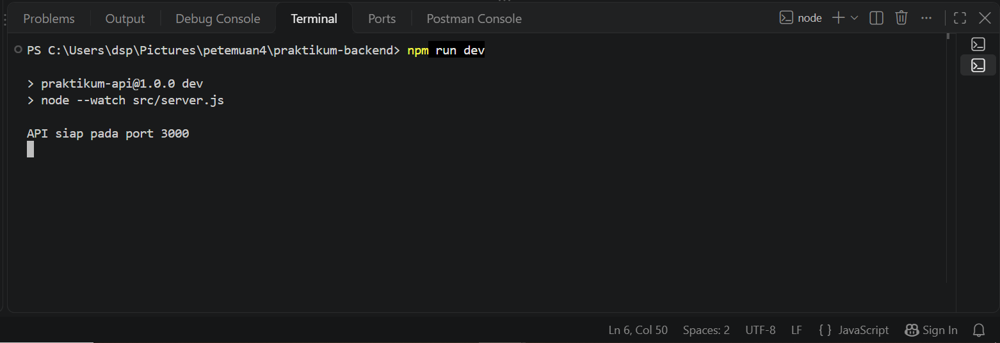

#### 3. Pemeriksaan Health Check

Pemeriksaan dilakukan melalui endpoint health check menggunakan perintah:

```bash
curl -i http://localhost:3000/api/v1/health
```

Hasil yang diharapkan adalah HTTP `200` dengan respons:

```json
{"status":"ok"}
```

**Bukti hasil health check:**

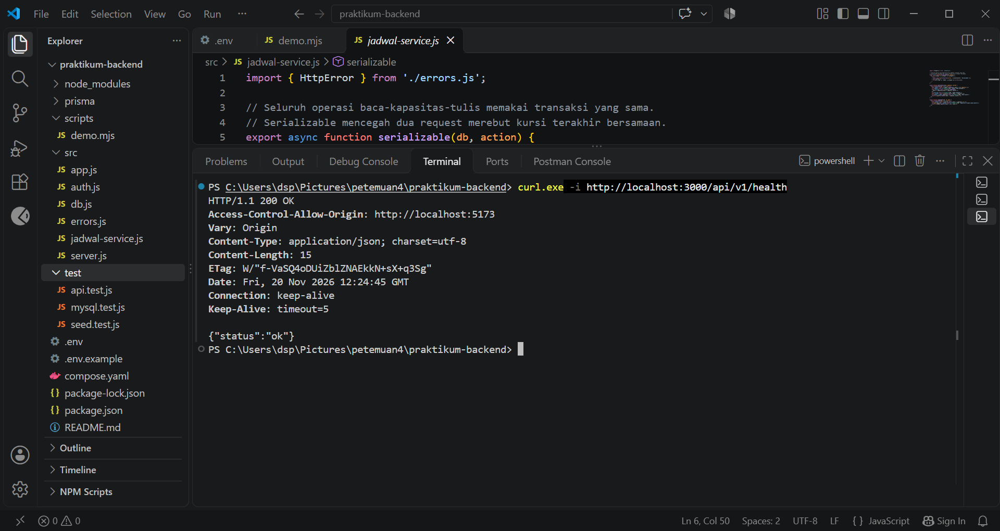

### C. Implementasi Praktikum

#### 1. Relasi Database

Pada praktikum ini digunakan tiga entitas utama, yaitu `User`, `Jadwal`, dan `Peserta`.

- `User` menyimpan informasi pengguna.
- `Jadwal` menyimpan informasi jadwal dan kapasitas.
- `Peserta` menyimpan informasi pendaftaran pengguna pada suatu jadwal.

Tabel `Peserta` memiliki relasi dengan tabel `User` dan `Jadwal`. Kombinasi `jadwalId` dan `userId` dibuat unik untuk mencegah pendaftaran ganda.

Relasi menerapkan `onDelete: Cascade` agar data peserta yang berkaitan ikut terhapus ketika jadwal atau pengguna dihapus.

Implementasi relasi diperiksa melalui file `prisma/schema.prisma`.

**Bukti implementasi relasi database:**

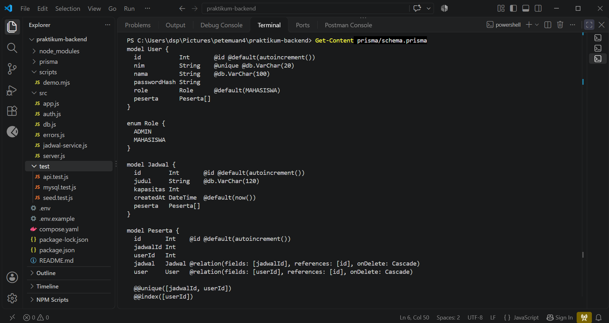

#### 2. Transaksi Serializable

Transaksi digunakan untuk memastikan pemeriksaan kapasitas dan penyimpanan peserta berjalan secara konsisten.

Operasi baca, pemeriksaan kapasitas, dan penulisan data dilakukan dalam satu transaksi dengan tingkat isolasi `Serializable`.

Apabila terjadi konflik transaksi dengan kode `P2034`, sistem melakukan retry maksimal tiga kali.

Implementasi transaksi terdapat pada file `src/jadwal-service.js`.

**Bukti implementasi transaksi Serializable:**

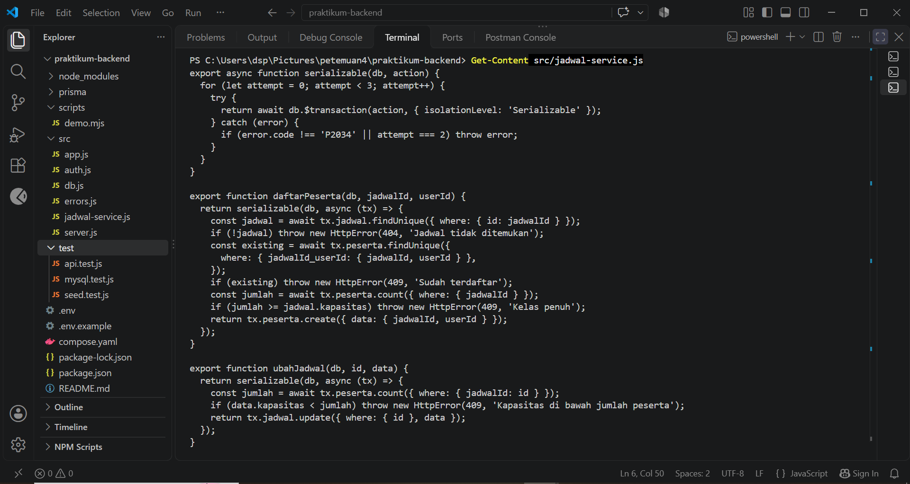

#### 3. Pendaftaran Peserta

Fungsi `daftarPeserta` digunakan untuk mendaftarkan pengguna ke suatu jadwal. Prosesnya meliputi:

1. Memeriksa keberadaan jadwal.
2. Memeriksa apakah pengguna sudah terdaftar.
3. Menghitung jumlah peserta.
4. Memeriksa kapasitas jadwal.
5. Menyimpan pendaftaran apabila seluruh pemeriksaan berhasil.

Jika jadwal tidak ditemukan, sistem memberikan HTTP `404`. Jika peserta sudah terdaftar atau kelas penuh, sistem memberikan HTTP `409`.

Identitas pengguna diperoleh dari `req.user.id` setelah token autentikasi diverifikasi. Body request tidak digunakan untuk menentukan identitas pengguna.

**Bukti implementasi pendaftaran peserta:**

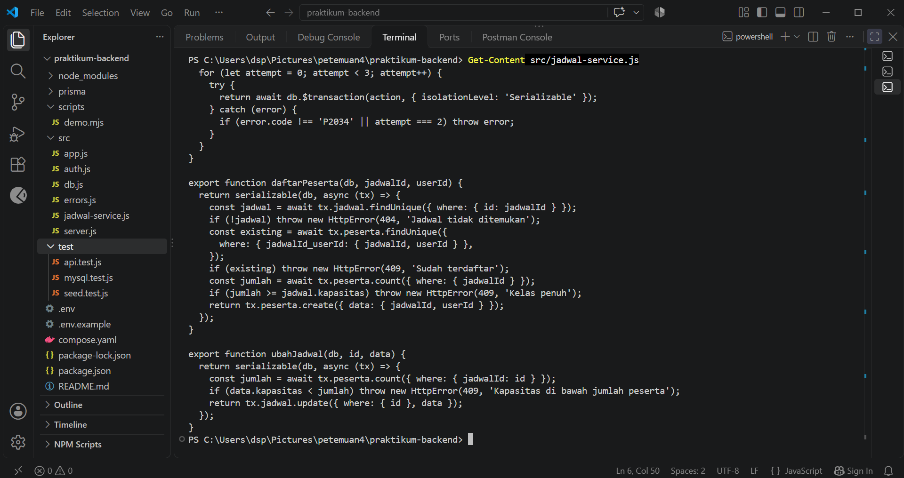

#### 4. Perubahan Kapasitas Jadwal

Fungsi `ubahJadwal` digunakan untuk memperbarui informasi jadwal. Sebelum kapasitas diperbarui, sistem menghitung jumlah peserta yang telah terdaftar.

Apabila kapasitas baru lebih kecil daripada jumlah peserta, perubahan ditolak dengan HTTP `409`. Pemeriksaan dan perubahan dilakukan dalam transaksi yang sama.

**Bukti implementasi perubahan kapasitas:**

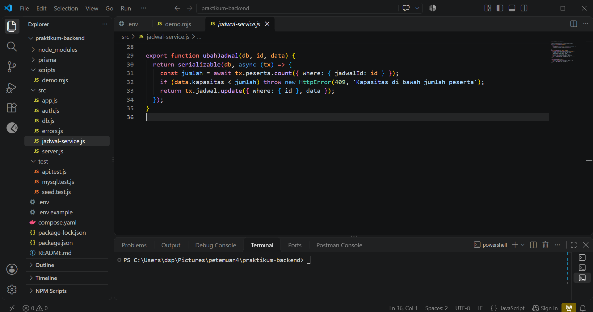

#### 5. Pembatalan Pendaftaran dan Cascade Delete

Pembatalan pendaftaran dilakukan melalui endpoint `DELETE /jadwal/:id/peserta/me`. Penghapusan dilakukan berdasarkan ID jadwal dan identitas pengguna yang sedang login.

Jika pendaftaran tidak ditemukan, sistem memberikan HTTP `404`.

Penghapusan jadwal sebagai admin menggunakan mekanisme cascade sehingga seluruh data peserta yang berhubungan dengan jadwal tersebut ikut terhapus.

**Bukti implementasi pembatalan dan cascade delete:**

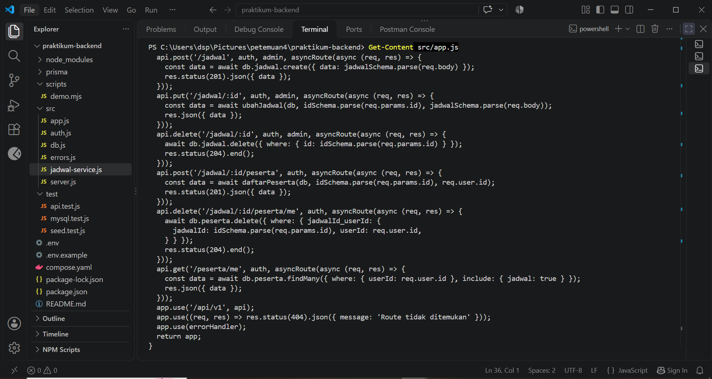

### D. Pengujian Praktikum

#### 1. Pengujian Demo Pendaftaran

Demo dijalankan menggunakan script yang disediakan dalam implementasi lengkap modul.

Perintah pada panduan modul:

```bash
node scripts/demo.mjs
```

Demo dijalankan setelah API dan seed siap.

Tahapan pengujian:

1. Membuat jadwal.
2. Mendaftarkan mahasiswa pertama.
3. Mencoba pendaftaran kedua.
4. Memastikan pendaftaran kedua ditolak dengan HTTP `409`.
5. Membatalkan pendaftaran.
6. Membersihkan jadwal pengujian.

**Bukti hasil pengujian demo:**

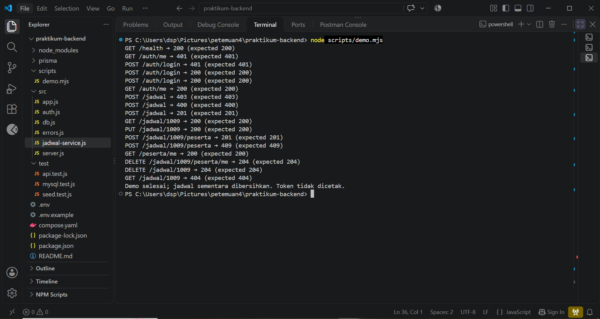

**Bukti penolakan pendaftaran kedua dengan HTTP 409:**

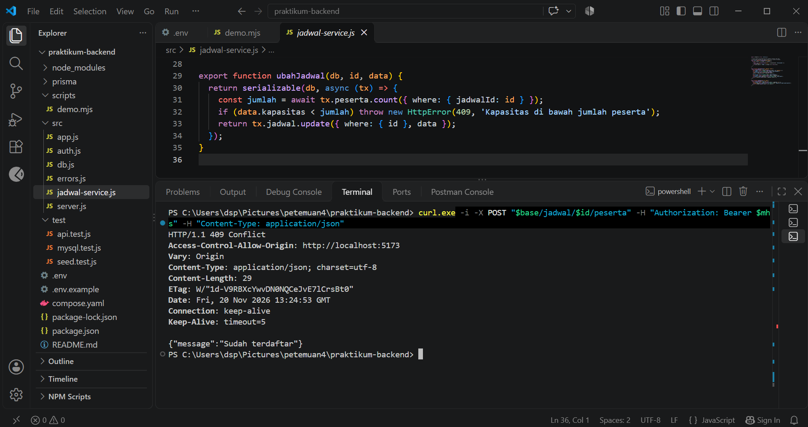

**Bukti pembatalan peserta:**

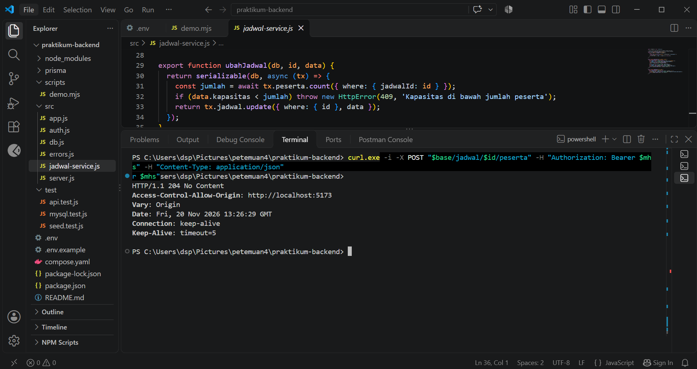

**Bukti penghapusan jadwal dan cascade:**

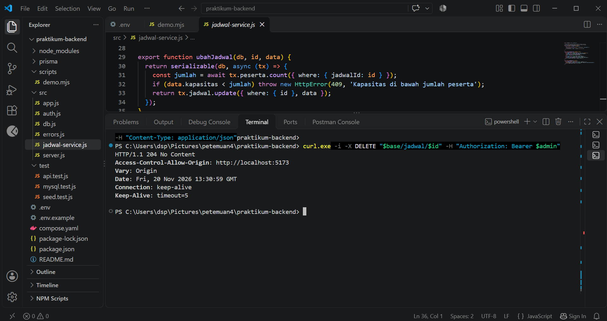

#### 2. Latihan Implementasi: Pengujian Kapasitas 1 dengan Dua Akun

Pengujian dilakukan dengan mengatur kapasitas jadwal menjadi satu peserta.

Tahapan pengujian:

1. Mengatur kapasitas jadwal menjadi `1`.
2. Mendaftarkan mahasiswa pertama menggunakan akun pertama.
3. Memastikan pendaftaran pertama berhasil.
4. Melakukan pendaftaran menggunakan akun mahasiswa kedua pada jadwal yang sama.
5. Memastikan pendaftaran kedua ditolak dengan HTTP `409` karena kelas sudah penuh.

Hasil yang diharapkan adalah hanya satu mahasiswa yang berhasil terdaftar, sedangkan mahasiswa kedua memperoleh respons `409`.

**Bukti pengujian kapasitas dengan dua akun:**

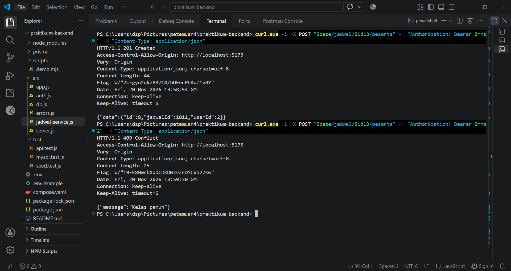

#### 3. Latihan Implementasi: Pengujian Perubahan Kapasitas 0 dan 1

Pengujian dilakukan terhadap jadwal dengan ID 1011 yang telah memiliki satu peserta terdaftar. Pengujian bertujuan untuk memastikan sistem dapat memvalidasi perubahan kapasitas berdasarkan jumlah peserta yang sudah terdaftar.

Pengujian pertama dilakukan dengan mengubah kapasitas menjadi 0. Sistem menolak permintaan dengan HTTP 400 karena kapasitas minimal yang diperbolehkan adalah 1.

Pengujian kedua dilakukan dengan mengubah kapasitas menjadi 1. Sistem menerima perubahan dengan HTTP 200 karena kapasitas tersebut masih mencukupi jumlah peserta yang terdaftar.

Hasil pemeriksaan melalui phpMyAdmin menunjukkan bahwa kapasitas jadwal tetap 1 dan jumlah peserta tetap 1.

**Bukti pengujian perubahan kapasitas 0 dan 1:**

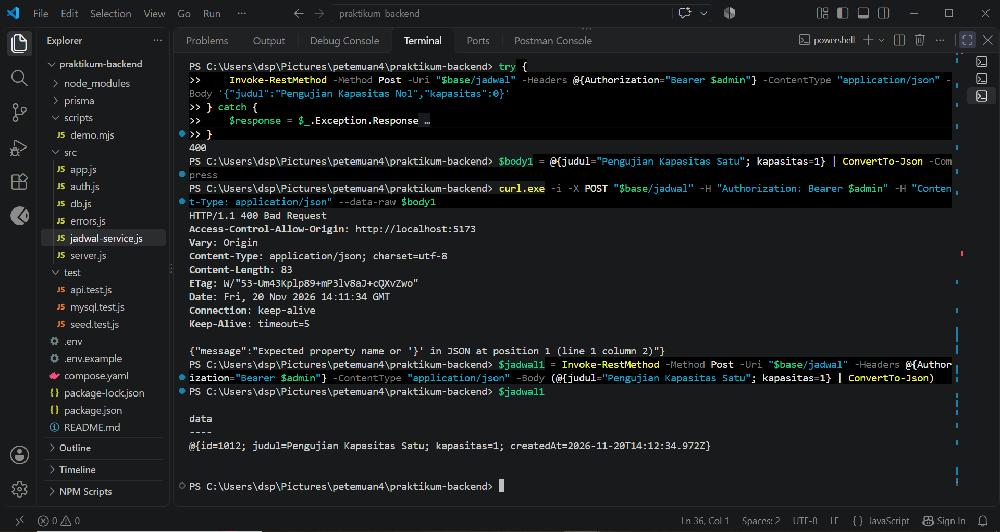

Pengujian dilakukan terhadap jadwal dengan ID 1011 yang telah memiliki satu peserta terdaftar. Pengujian bertujuan untuk memastikan sistem dapat memvalidasi perubahan kapasitas berdasarkan jumlah peserta yang sudah terdaftar.

**a. Pengujian Mengubah Kapasitas Menjadi 0**

Pengujian pertama dilakukan dengan mengubah kapasitas jadwal menjadi 0 ketika terdapat satu peserta yang telah terdaftar. Sistem menolak permintaan dengan HTTP 400 karena kapasitas minimal yang diperbolehkan adalah 1.

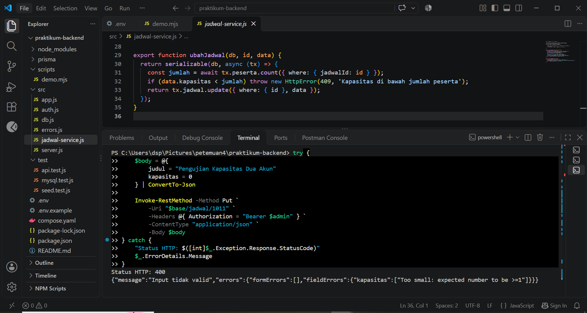

**b. Pengujian Mengubah Kapasitas Menjadi 1**

Pengujian kedua dilakukan dengan mengubah kapasitas jadwal menjadi 1. Sistem menerima perubahan dengan HTTP 200 karena kapasitas tersebut masih mencukupi jumlah peserta yang terdaftar.

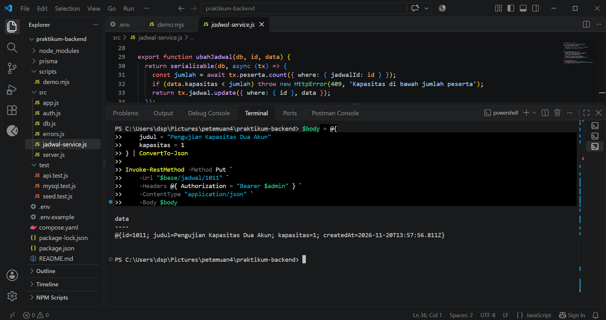

**c. Verifikasi Data pada Database**

Setelah pengujian selesai, dilakukan pemeriksaan melalui phpMyAdmin untuk memastikan perubahan kapasitas tersimpan dan jumlah peserta tetap konsisten. Hasil pemeriksaan menunjukkan bahwa jadwal dengan ID 1011 memiliki kapasitas 1 dan jumlah peserta 1.

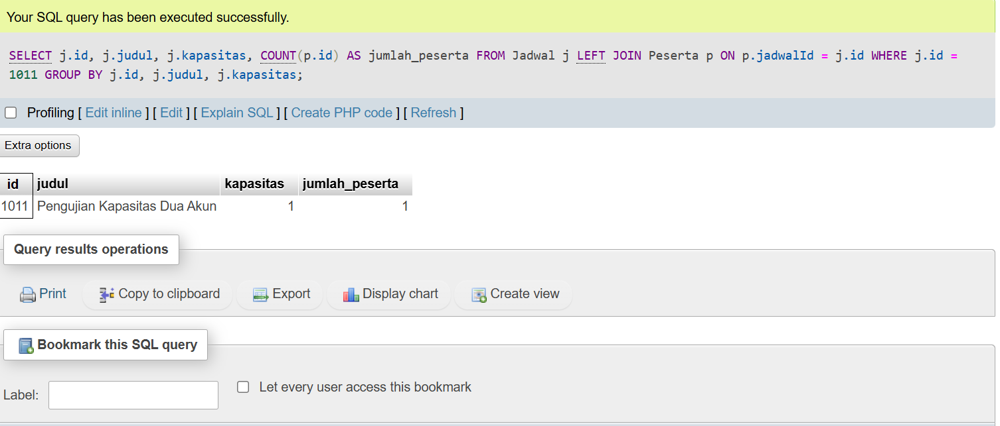

#### 4. Pengujian Unit Test

Unit test dilakukan untuk memeriksa aturan transaksi tanpa menghubungkan pengujian ke database secara langsung.

Perintah sesuai modul:

```bash
npm test
```

Pengujian meliputi:

1. Pendaftaran ketika kelas masih tersedia.
2. Penolakan ketika kelas penuh.
3. Penolakan pendaftaran ganda.
4. Penanganan jadwal yang tidak ditemukan.
5. Retry ketika terjadi konflik transaksi.

**Bukti hasil unit test:**

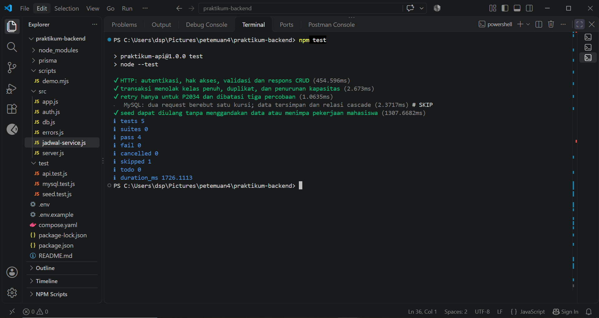

Unit test membantu memastikan logika program berjalan sesuai skenario. Namun, unit test saja belum membuktikan bahwa isolasi transaksi berjalan pada database sebenarnya.

#### 5. Pengujian Database Test

Database test dilakukan untuk memeriksa transaksi dan relasi secara langsung pada database.

Perintah sesuai modul:

```bash
$env:RUN_DB_TESTS="1"
npm test
```

Pengujian dilakukan setelah MySQL aktif, konfigurasi koneksi sesuai, dan database telah dimigrasikan.

**Bukti hasil database test:**

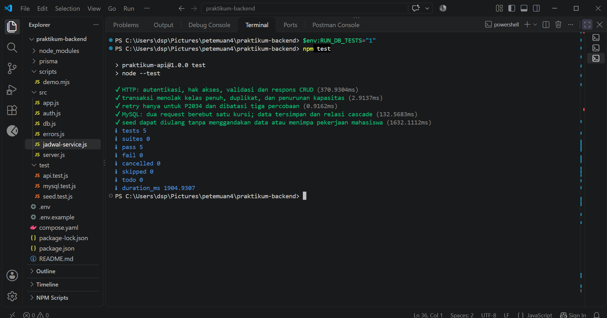

Pengujian ini memberikan bukti tambahan mengenai perilaku transaksi dan konsistensi data pada database yang digunakan.


#### 6. Potongan Kode Penting

**a. Fungsi Transaksi Serializable**

Fungsi `serializable()` digunakan untuk menjalankan transaksi dengan tingkat isolasi Serializable dan melakukan retry maksimal tiga kali apabila terjadi konflik dengan kode P2034.

```javascript
export async function serializable(db, action) {
  for (let attempt = 0; attempt < 3; attempt++) {
    try {
      return await db.$transaction(action, {
        isolationLevel: 'Serializable'
      });
    } catch (error) {
      if (error.code !== 'P2034' || attempt === 2) throw error;
    }
  }
}
```

**b. Fungsi Pendaftaran Peserta**

Fungsi `daftarPeserta()` memeriksa jadwal, pendaftaran ganda, dan kapasitas sebelum menyimpan data peserta melalui transaksi database.

```javascript
export function daftarPeserta(db, jadwalId, userId) {
  return serializable(db, async (tx) => {
    const jadwal = await tx.jadwal.findUnique({
      where: { id: jadwalId }
    });

    if (!jadwal) {
      throw new HttpError(404, 'Jadwal tidak ditemukan');
    }

    const existing = await tx.peserta.findUnique({
      where: {
        jadwalId_userId: { jadwalId, userId }
      }
    });

    if (existing) {
      throw new HttpError(409, 'Sudah terdaftar');
    }

    const jumlah = await tx.peserta.count({
      where: { jadwalId }
    });

    if (jumlah >= jadwal.kapasitas) {
      throw new HttpError(409, 'Kelas penuh');
    }

    return tx.peserta.create({
      data: { jadwalId, userId }
    });
  });
}
```

**c. Fungsi Perubahan Kapasitas**

Fungsi `ubahJadwal()` menghitung jumlah peserta sebelum memperbarui jadwal. Perubahan ditolak apabila kapasitas baru lebih kecil daripada jumlah peserta yang telah terdaftar.

```javascript
export function ubahJadwal(db, id, data) {
  return serializable(db, async (tx) => {
    const jumlah = await tx.peserta.count({
      where: { jadwalId: id }
    });

    if (data.kapasitas < jumlah) {
      throw new HttpError(
        409,
        'Kapasitas di bawah jumlah peserta'
      );
    }

    return tx.jadwal.update({
      where: { id },
      data
    });
  });
}
```


### E. Tabel Hasil Pengujian

| No. | Skenario | Hasil yang Diharapkan | Hasil Aktual |
|---|---|---|---|
| 1 | Database aktif | MySQL berjalan | **Berhasil**, MySQL aktif melalui XAMPP. |
| 2 | Backend aktif | API berjalan pada port 3000 | **Berhasil**, backend aktif pada port 3000. |
| 3 | Health check | HTTP 200 | **Berhasil**, API mengembalikan HTTP 200 dengan status `ok`. |
| 4 | Membuat jadwal | Jadwal berhasil dibuat | **Berhasil**, jadwal berhasil dibuat dengan HTTP 201. |
| 5 | Pendaftaran pertama | Peserta berhasil terdaftar | **Berhasil**, peserta berhasil didaftarkan dengan HTTP 201. |
| 6 | Pendaftaran kedua | Ditolak HTTP 409 | **Berhasil**, pendaftaran duplikat ditolak dengan HTTP 409. |
| 7 | Pembatalan peserta | Pendaftaran terhapus | **Berhasil**, pendaftaran peserta berhasil dibatalkan dengan HTTP 204. |
| 8 | Penghapusan jadwal | Data peserta terkait ikut terhapus | **Berhasil**, jadwal terhapus dan data peserta terkait ikut terhapus melalui cascade. |
| 9 | Kapasitas 1 dengan dua akun | Akun kedua ditolak HTTP 409 | **Berhasil**, akun pertama berhasil mendaftar dengan HTTP 201, sedangkan akun kedua ditolak dengan HTTP 409 karena kelas penuh. |
| 10 | Membuat jadwal dengan kapasitas 0 | Ditolak HTTP 400 | **Berhasil**, pembuatan jadwal dengan kapasitas 0 ditolak oleh validasi input. |
| 11 | Membuat jadwal dengan kapasitas 1 | Jadwal berhasil dibuat | **Berhasil**, jadwal dengan kapasitas 1 berhasil dibuat. |
| 12 | Mengubah kapasitas menjadi 0 saat terdapat 1 peserta | Perubahan ditolak HTTP 400 | **Berhasil**, sistem menolak perubahan karena kapasitas minimal adalah 1. |
| 13 | Mengubah kapasitas menjadi 1 saat terdapat 1 peserta | Perubahan diterima HTTP 200 | **Berhasil**, kapasitas 1 diterima karena sesuai dengan jumlah peserta yang terdaftar. |
| 14 | Unit test | Skenario pengujian berjalan sesuai harapan | **Berhasil**, 4 pengujian lulus, 0 gagal, dan 1 dilewati karena pengujian MySQL belum diaktifkan. |
| 15 | Database test | Pengujian database berjalan sesuai harapan | **Berhasil**, seluruh 5 pengujian lulus, 0 gagal, dan 0 dilewati setelah pengujian MySQL diaktifkan. |


## F. Pertanyaan Penjelasan Kode

### 1. Dari mana input fitur ini berasal, dan di file mana input tersebut diperiksa?

Input fitur pendaftaran peserta berasal dari HTTP request yang dikirim oleh pengguna melalui endpoint API. Pengguna yang sudah login mengirimkan ID jadwal melalui parameter URL, sedangkan identitas pengguna diperoleh dari token autentikasi JWT.

Pemeriksaan autentikasi dan hak akses dilakukan melalui middleware pada file `src/app.js`. Sementara itu, validasi data jadwal dilakukan menggunakan Zod melalui schema yang terdapat di file tersebut. Selanjutnya, proses pendaftaran peserta diteruskan ke fungsi `daftarPeserta()` pada file `src/jadwal-service.js` untuk memeriksa keberadaan jadwal, pendaftaran duplikat, dan ketersediaan kapasitas.

### 2. Fungsi mana yang mengubah data atau state, dan kapan respons ditampilkan kepada pengguna?

Fungsi yang mengubah data pada fitur pendaftaran peserta adalah `daftarPeserta()` yang terdapat pada file `src/jadwal-service.js`.

Fungsi tersebut menjalankan pemeriksaan jadwal, memeriksa apakah pengguna sudah terdaftar, menghitung jumlah peserta, dan menyimpan pendaftaran menggunakan `tx.peserta.create()`.

Seluruh proses tersebut dijalankan dalam transaksi database menggunakan tingkat isolasi `Serializable`. Setelah proses database berhasil, hasilnya diteruskan ke handler endpoint pada `src/app.js` untuk dikirimkan sebagai respons HTTP kepada pengguna. Jika terjadi kesalahan, API mengirimkan respons error sesuai kondisi yang terjadi.

### 3. Apa yang terjadi jika request gagal pada titik sebelum penyimpanan dan sesudah penyimpanan? Gunakan satu fungsi konkret dari source di atas.

Contoh yang digunakan adalah fungsi `daftarPeserta()` pada file `src/jadwal-service.js`.

**a. Jika request gagal sebelum penyimpanan**

Apabila jadwal tidak ditemukan, pengguna sudah terdaftar, atau kapasitas kelas sudah penuh, fungsi akan menghasilkan error sebelum menjalankan `tx.peserta.create()`. Dengan demikian, data pendaftaran baru tidak disimpan ke database.

**b. Jika request gagal setelah proses penyimpanan dilakukan**

Apabila terjadi kesalahan ketika transaksi belum selesai atau belum berhasil di-commit, transaksi database akan dibatalkan (rollback). Data pendaftaran yang dibuat di dalam transaksi tersebut tidak akan tersimpan secara permanen.

Jika transaksi sudah berhasil di-commit tetapi respons HTTP gagal dikirim atau terputus, data pendaftaran tetap tersimpan di database. Pengguna mungkin tidak menerima respons keberhasilan, sehingga ketika mencoba mendaftar kembali, sistem akan menolak pendaftaran duplikat dengan HTTP 409.

Dari penjelasan tersebut, transaksi database membantu menjaga konsistensi data agar proses pendaftaran tidak menghasilkan data yang tidak sesuai dengan aturan kapasitas dan relasi peserta.

### G. Analisis dan Pembahasan

#### 1. Sumber Input dan Proses Pemeriksaan

Input fitur pendaftaran berasal dari request yang dikirim pengguna melalui endpoint API. Identitas pengguna diperoleh dari `req.user.id` setelah token autentikasi diverifikasi, sedangkan ID jadwal berasal dari parameter request.

Endpoint `/peserta/me` digunakan untuk membaca pendaftaran milik pengguna yang sedang aktif. Dengan demikian, pengguna tidak dapat memilih identitas orang lain melalui body atau query request.

#### 2. Urutan Aturan Pendaftaran

Fungsi `daftarPeserta` menjalankan pemeriksaan secara berurutan, yaitu mencari jadwal, memeriksa pendaftaran ganda, menghitung jumlah peserta, membandingkan jumlah peserta dengan kapasitas, lalu menyimpan data pendaftaran.

Jadwal yang tidak ditemukan menghasilkan HTTP `404`, sedangkan pendaftaran ganda dan kelas penuh menghasilkan HTTP `409`.

#### 3. Fungsi yang Mengubah Data

Fungsi `daftarPeserta` melakukan perubahan data melalui operasi `tx.peserta.create()`. Operasi penyimpanan dilakukan setelah seluruh pemeriksaan berhasil.

Respons kepada pengguna diberikan setelah transaksi berhasil diselesaikan. Jika terjadi kesalahan, sistem meneruskan error ke mekanisme penanganan kesalahan.

#### 4. Kegagalan Sebelum dan Sesudah Penyimpanan

Jika permintaan gagal sebelum operasi penyimpanan dilakukan, data peserta belum ditambahkan ke database. Contohnya ketika jadwal tidak ditemukan atau kapasitas kelas sudah penuh.

Jika terjadi kegagalan ketika transaksi berlangsung sebelum commit, perubahan yang belum berhasil dikomit tidak boleh dianggap sebagai data yang telah tersimpan. Transaksi membantu menjaga konsistensi perubahan data.

#### 5. Pentingnya Serializable dan Retry

`Serializable` digunakan untuk menjaga konsistensi ketika beberapa pengguna melakukan pendaftaran secara bersamaan. Apabila terjadi konflik transaksi, sistem dapat mengulang proses maksimal tiga kali selama error yang terjadi adalah `P2034`.

Error validasi bisnis dan koneksi tidak diulang menggunakan mekanisme retry tersebut.

#### 6. Peran Unique Constraint dan Foreign Key

Unique constraint pada kombinasi `jadwalId` dan `userId` mencegah pendaftaran ganda. Foreign key menjaga agar peserta hanya terhubung dengan pengguna dan jadwal yang tersedia.

Kedua mekanisme tersebut menjaga integritas data pada tingkat database.

#### 7. Kapasitas Saat Jadwal Diubah

Fungsi `ubahJadwal` menghitung jumlah peserta dalam transaksi yang sama dengan proses pembaruan jadwal. Admin tidak dapat menurunkan kapasitas di bawah jumlah peserta yang telah terdaftar.

Jalur perubahan kapasitas juga menggunakan tingkat isolasi transaksi yang sama agar aturan kapasitas tetap terjaga.

#### 8. Pembatalan dan Penghapusan

Pembatalan pendaftaran menghapus data berdasarkan gabungan `jadwalId` dan `userId` pengguna aktif. Pendaftaran yang tidak ditemukan menghasilkan HTTP `404`.

Penghapusan jadwal sebagai admin menghapus seluruh pendaftaran yang berhubungan melalui mekanisme `onDelete: Cascade`.

#### 9. Analisis Hasil Pengujian

Pengujian kapasitas satu dengan dua akun menunjukkan apakah sistem dapat membatasi jumlah peserta sesuai kapasitas yang ditentukan. Pengujian kapasitas nol dan satu membantu membedakan validasi angka dengan aturan bisnis jumlah peserta.

Unit test memeriksa logika transaksi, sedangkan database test memberikan bukti tambahan mengenai perilaku transaksi dan integritas data pada database sebenarnya.


### H. Kesimpulan

Berdasarkan praktikum Pertemuan 06, dapat disimpulkan bahwa relasi database dan transaksi memiliki peran penting dalam menjaga konsistensi data pada proses pendaftaran peserta.

Penerapan transaksi `Serializable` membantu menjaga konsistensi ketika beberapa pengguna melakukan pendaftaran secara bersamaan. Pemeriksaan jadwal, pendaftaran ganda, dan jumlah peserta juga diperlukan sebelum data disimpan.

Mekanisme retry, unique constraint, foreign key, dan cascade delete membantu menjaga integritas data serta menangani konflik dan penghapusan data yang saling berhubungan.

Berdasarkan hasil pengujian, seluruh lima pengujian pada pengujian database berhasil dijalankan tanpa kegagalan. Pengujian manual juga menunjukkan bahwa sistem berhasil menolak pendaftaran ketika kelas penuh, mencegah pendaftaran ganda, serta memvalidasi perubahan kapasitas jadwal sesuai jumlah peserta yang terdaftar.

Dengan demikian, implementasi dan pengujian Praktikum Pertemuan 06 telah berhasil dilakukan sesuai skenario yang dikerjakan.
